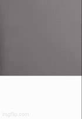

# ASL - Arabic Sign Language
Arabic Sign Language gesture detection using mediapipe and openCV
## Arabic Hand Gesture Recognition System

  

### Project Overview

This system extends Kazuhito00's Hand Gesture Recognition by adding support for:

- The complete 28-letter Arabic alphabet

- 3 functional gestures (Space, Delete, Clear)

- Real-time text output with Arabic script rendering

### Key Features
✋ 28 Arabic Letters: Custom-trained gesture models for all Arabic characters

🛠 Utility Gestures:

- 👉 Space: Insert space between words
- ❌ Delete: Remove last character
- 🧹 Clear: Reset entire text

📜 Arabic Text Rendering: Proper RTL display with glyph shaping

⚡ Adjustable Sensitivity: Control detection speed via frame threshold

### Technologies Used

- MediaPipe – Hand tracking

- OpenCV – Camera processing & visualization

- NumPy – Data handling

- Model: CNN – Static gesture classification

### Getting Started
*This section includes the requirements, how to run the app, training protocol and other more detailed information about the original hand gesture detection model*

Please view the README of Kazuhito00's Hand Gesture Recognition Repo: https://github.com/kinivi/hand-gesture-recognition-mediapipe

Additional requirements
+ arabic_reshaper 3.0.0
+ python-bidi 0.6.6
+ pillow 11.2.1 

### Training Protocol For Higher Accuracy

Assume you want to increase the accuracy of a letter for index 23 in "keypoint_classifier_label.csv":

1. search (shift + f) for the line of code with "number +" in it
2. Add 20 after the "+"  *index 0 to 9: add 0, index 10 to 19: add 10*
3. Run app.py
4. Press k to enter training mode
5. Press 2 (for 20 + 2 = 22) while doing the hand gesture to the camera to take a screenshot of the hand landmarks coordinates *Note: CSV uses 0-based indexing while labels start from 1*
6. Screenshot the gesture at least 20 times
7. Stop app.py
8. Open "keypoint_classification_EN" in Jupyter notebook and run all the cells

Training done ✅

Kazuhito00's Hand Gesture Recognition Repo: https://github.com/kinivi/hand-gesture-recognition-mediapipe
